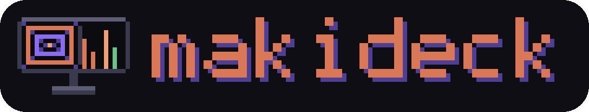
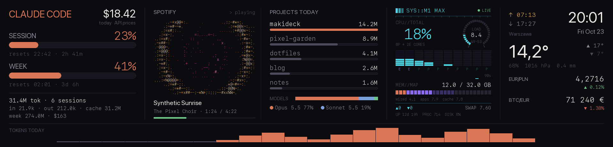
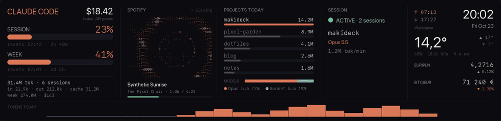
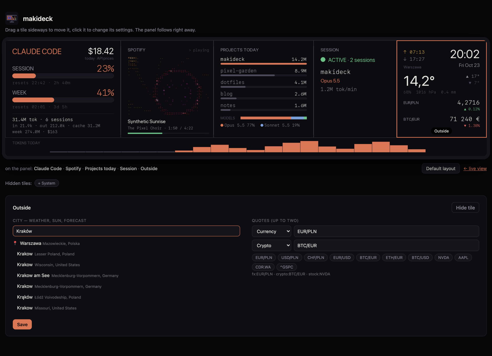
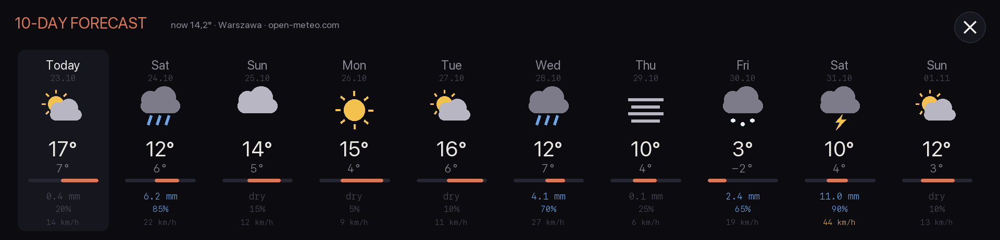

<p align="center"></p>

<p align="center"><b>A desk deck for Claude Code.</b><br>
Plan usage, spend and live sessions on a 9.16" USB panel next to your keyboard.
Spotify gets an ASCII flight that moves with the music, the weather and your
quotes sit beside it, and you arrange all of it by dragging tiles in your browser.</p>



## What's on it

| Tile | Shows | From |
| --- | --- | --- |
| **Claude Code** | session and weekly plan usage with reset countdowns, today's tokens and their API-price equivalent | Claude Code's usage endpoint (your own login), [ccusage](https://github.com/ryoppippi/ccusage) |
| **Spotify** | the track playing, over an ASCII tunnel (or a warp starfield) pulsing to the beat | Spotify desktop app; real audio via [BlackHole](https://github.com/ExistentialAudio/BlackHole) if you want it |
| **Projects today** | where today's tokens went and the split between models | Claude Code's session transcripts, read locally |
| **Session** | whether Claude is working right now, on what, with which model, how fast | the same transcripts |
| **Outside** | clock, sunrise and sunset, weather for your city (tap for 10 days) and two quotes (currencies, crypto or stocks) | Open-Meteo, NBP, Kraken, Yahoo Finance; no keys needed |

The footer is today's tokens per hour. Everything except the usage query and
the weather/price lookups stays on your Mac.

## Arrange it in the editor

<http://127.0.0.1:8787/editor> (or **Edit deck…** in the menu bar). Drag tiles
to reorder them. Click a tile to change its settings, or to hide it. Hidden
tiles and your own modules wait in a tray under the panel. The panel changes
as soon as you let go.





The panel has no touch screen, so the live view at <http://127.0.0.1:8787/> is
the remote. Click the visualizer to switch scenes, or the weather for the forecast:



## Hardware

| Panel | USB ID | Resolution | Status |
| --- | --- | --- | --- |
| **Thermalright Trofeo Vision 9.16"** | `0416:5408` | 1920×462 | ✅ what makideck is made on |
| Thermalright Trofeo Vision 6.86" | `0416:5302` | 1280×480 | 🟡 driver included, not tested on a real unit |

Get the 9.16" if you're buying for this. It's sold as a PC case temperature
display, but on a desk clamp or a small stand it's a perfect strip under a
monitor. More in [docs/hardware.md](docs/hardware.md).

## Install

You need macOS, Python 3.12+, [uv](https://docs.astral.sh/uv/), Node (for
`npx ccusage`), Claude Code logged in, and:

```bash
brew install libusb hidapi
git clone https://github.com/makyox/makideck && cd makideck
uv sync
uv run makideck run --demo --no-panel   # try it without a panel: open http://127.0.0.1:8787/editor
uv run makideck login on                # the menu bar icon at login; it runs the deck
```

The first real run asks for Keychain access to "Claude Code-credentials"
(choose *Always Allow*). It also asks once whether makideck may control Spotify.

| Command | |
| --- | --- |
| `makideck run` | drive the panel and serve the live view and editor (`--demo`, `--no-panel`) |
| `makideck menubar` | the menu bar icon: start/stop, sleep the panel now / at night / never, editor, logs |
| `makideck preview out.png` | render a frame from demo data (`--view forecast`, `--live`) |
| `makideck login on\|off` | open the menu bar app at login |

Settings that aren't about tiles (frame rate, night hours, web
port) go in `~/.config/makideck/config.toml`. See
[config.example.toml](config.example.toml). The layout and tile settings live in
`~/.config/makideck/deck.json`, and logs go to `~/Library/Logs/makideck/`.

### Make the visualizer hear the music

Without extra setup the tunnel follows a beat derived from the track. To make it react to
the actual sound:

```bash
brew install blackhole-2ch
swift tools/multi_output.swift      # "Deck Output" = your speakers + BlackHole, set as output
```

Bass then drives the flight speed, kicks flash the rings and mids twist the
tunnel.

## Write your own tile

A tile is one Python file in `~/.config/makideck/tiles/`:

```python
from makideck.deck import Ctx, Field, Tile, register
from makideck.render import theme

def render(c: Ctx) -> None:
    c.d.text((c.left, 26), c.settings["greeting"].upper(), font=theme.sans(18), fill=theme.DIM)

register(Tile("hello", "Hello", 300, render,
              fields=(Field("greeting", "Greeting"),), defaults={"greeting": "hi"}))
```

It shows up in the editor's tray, and its settings form is built from `fields`.
[docs/tiles.md](docs/tiles.md) covers drawing, data sources, taps, full-screen
views and animation. [examples/countdown.py](examples/countdown.py) is a
complete tile.

## Credits

- [thermalright-trcc-linux](https://github.com/Lexonight1/thermalright-trcc-linux) did the hard part:
  reverse-engineering the panels' USB protocols. makideck uses its device classes.
- [ccusage](https://github.com/ryoppippi/ccusage) for token and cost accounting.
- Open-Meteo, NBP, Kraken, Yahoo Finance and GIG (meteo.gig.eu) for the outside world.
- The idea of a Claude usage strip on a cheap LCD comes from the "$38 Claude LCD Table Display"
  post on r/ClaudeAI.

makideck isn't affiliated with Anthropic, Thermalright or Spotify.

## License

[GPL-3.0-or-later](LICENSE), the same as trcc, which makideck builds on.
